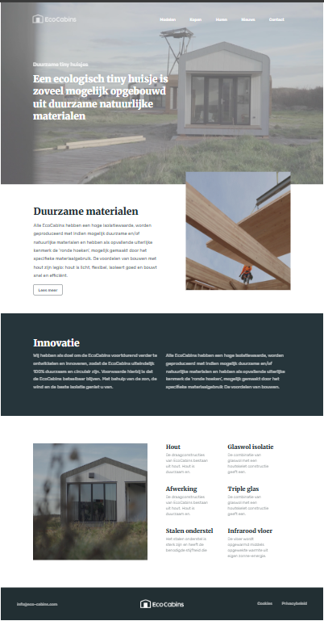

# EcoCabins — Landing Page

Одностраничный адаптивный лендинг для компании EcoCabins, специализирующейся на строительстве экологичных домов (tiny houses).

## 🛠️ Технологии
*   **HTML5** (семантическая верстка)
*   **CSS3** (Flexbox, Grid, кастомные свойства)
*   **Bootstrap 5** (сетка, модальные окна)
*   **Google Fonts** (Rubik, Merriweather)

## ✨ Особенности реализации
*   Использован `modern-normalize` для сброса стилей браузера.
*   Адаптивная верстка (поддержка мобильных устройств, планшетов и десктопов).
*   Реализовано модальное окно (popup) для кнопки "Lees meer" с помощью Bootstrap.
*   Кастомные медиазапросы для точной настройки отображения на разных экранах.

## 🚀 Как запустить
Просто откройте файл `index.html` в любом современном браузере. Проект не требует установки зависимостей или сборки.

## 👤 Автор
## 👤 Автор
Petr Levchenko — [Мой профиль на GitHub](https://github.com/petrlevchenko)
